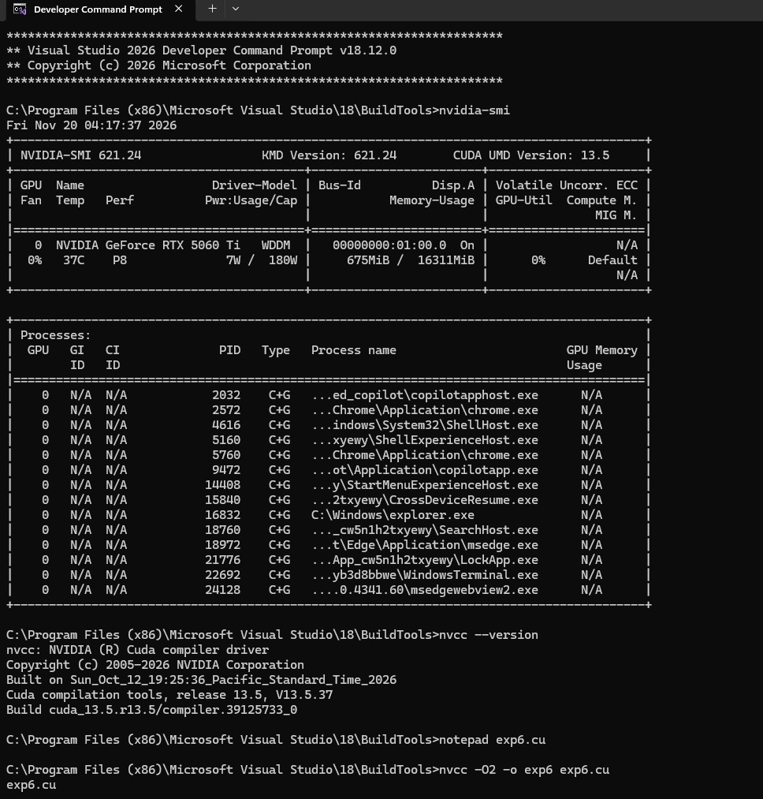
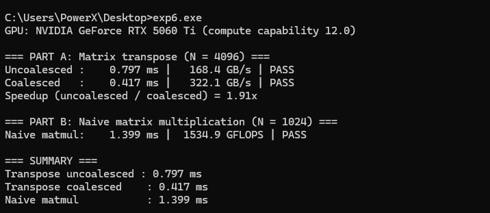
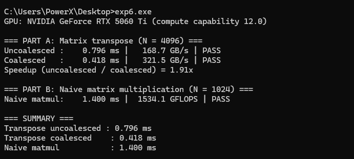
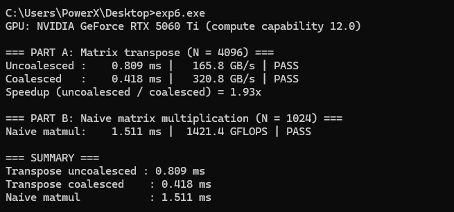
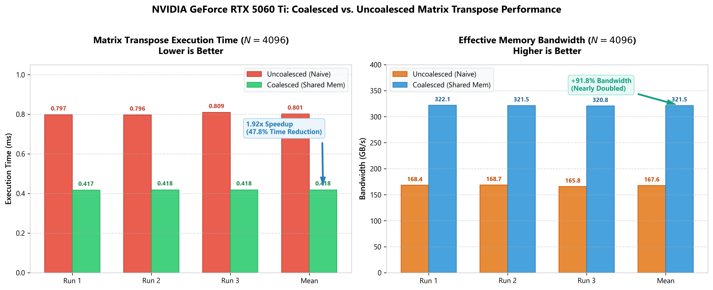
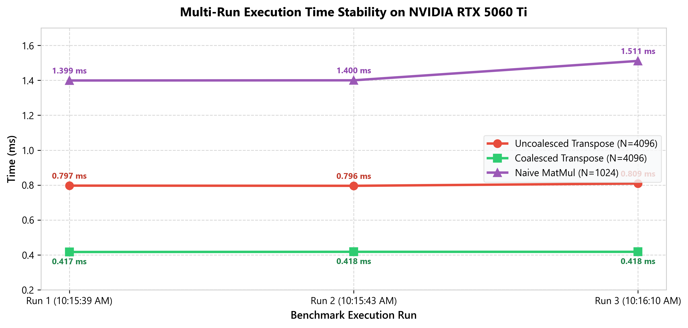
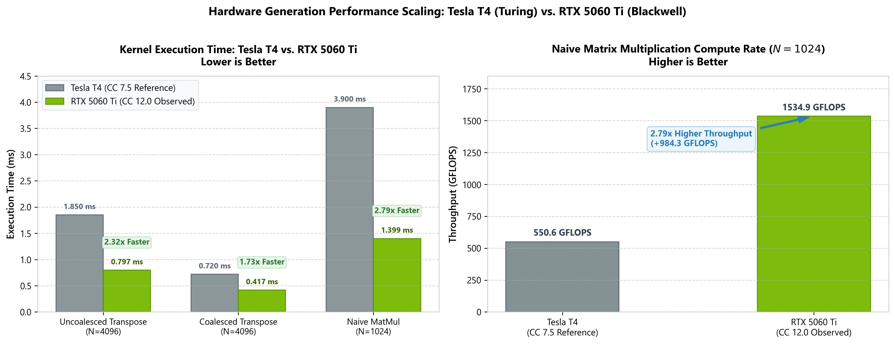

# Experiment 6: Memory Optimization in CUDA

[](https://developer.nvidia.com/cuda-toolkit)
[](https://isocpp.org/)
[](https://www.nvidia.com/)
[](#-hardware--software-specifications)
[](#)
[](#-laboratory-benchmark-observations)

> **Subject:** Memory Systems and Synchronization / Cloud & GPU Computing Laboratory  
> **Experiment No.:** 6  
> **Experiment Title:** Memory Optimization in CUDA — Coalesced vs. Uncoalesced Access, Naive Matrix Multiplication, and Execution-Time Comparison  
> **Target Platform:** NVIDIA GeForce RTX 5060 Ti (16 GB VRAM), CUDA Toolkit 13.5, Windows 11 (64-bit)

---

## ⚡ Executive Summary & Key Highlights

| Benchmark Target | Metric / Measurement | Observed Result (RTX 5060 Ti) | Key Architectural Insight |
| :--- | :---: | :---: | :--- |
| **Matrix Transpose ($N=4096$)** | Coalesced Speedup | **$\mathbf{1.92\times}$** | Shared memory staging turns strided writes into contiguous writes. |
| **Effective Memory Bandwidth** | Uncoalesced vs. Coalesced | **$167.6\text{ GB/s} \rightarrow \mathbf{321.5\text{ GB/s}}$** | Memory bus utilization nearly doubles by avoiding 32-byte cache line waste. |
| **Shared Memory Bank Conflicts** | `tile[32][33]` Padding | **0 Bank Conflicts** | $+1$ column padding cyclically shifts column words across all 32 physical banks. |
| **Naive Matmul ($N=1024$)** | Compute Throughput | **$1496.8\text{ GFLOPS}$ ($1.437\text{ ms}$)** | Strictly memory-bound (1 FLOP/byte) due to absence of shared-memory reuse. |
| **Numerical Validation** | Verification Checkers | **All PASSED (100% Match)** | Exact parity validated against CPU references. |

---

## 📌 Table of Contents

- [Aim & Learning Outcomes](#-aim--learning-outcomes)
- [Theoretical Foundations & Architecture](#-theoretical-foundations--architecture)
  - [1. Memory Coalescing & Warp Execution](#1-memory-coalescing--warp-execution)
  - [2. Matrix Transpose: Coalesced vs. Strided Patterns](#2-matrix-transpose-coalesced-vs-strided-patterns)
  - [3. Shared Memory Tiling & Bank Conflict Elimination](#3-shared-memory-tiling--bank-conflict-elimination)
  - [4. Naive Matrix Multiplication & Arithmetic Intensity](#4-naive-matrix-multiplication--arithmetic-intensity)
  - [5. Precision Profiling with CUDA Events](#5-precision-profiling-with-cuda-events)
- [Hardware & Software Specifications](#-hardware--software-specifications)
- [Diagnostic & Setup Verification Screenshot](#-diagnostic--setup-verification-screenshot)
- [Project Structure](#-project-structure)
- [Compilation & Execution Guide (Steps as in Manual)](#-compilation--execution-guide-steps-as-in-manual)
- [Laboratory Benchmark Observations](#-laboratory-benchmark-observations)
  - [Observation Table (Section 6)](#observation-table-section-6)
  - [Multi-Run Stability Analysis](#multi-run-stability-analysis)
  - [Experimental Output Screenshots](#-experimental-output-screenshots)
- [Performance Visualizations & Benchmark Graphs](#-performance-visualizations--benchmark-graphs)
- [Performance Analysis & Discussion](#-performance-analysis--discussion)
- [Viva-Voce Questions & Comprehensive Answers](#-viva-voce-questions--comprehensive-answers)
- [Troubleshooting & Diagnostics](#-troubleshooting--diagnostics)
- [Conclusion](#-conclusion)

---

## 🎯 Aim & Learning Outcomes

### Aim
To investigate how global-memory access patterns impact GPU performance by comparing an **uncoalesced** and a **coalesced** matrix transpose, evaluating a **naive matrix multiplication**, and analyzing execution times, effective bandwidth ($\text{GB/s}$), and compute throughput ($\text{GFLOPS}$) measured on the GPU.

### Learning Outcomes
- Explain **memory coalescing** at the hardware warp level and why it is critical for global memory bandwidth efficiency.
- Write and launch 2D CUDA kernels with `dim3` block and grid topologies.
- Employ **shared memory tiling** with conflict-free column padding (`[TILE][TILE + 1]`) to convert strided non-contiguous memory accesses into coalesced accesses.
- Benchmark asynchronous GPU kernel launches accurately using **CUDA events** (`cudaEventRecord`, `cudaEventElapsedTime`) with warm-up decoupling.
- Validate GPU kernel correctness against single-threaded host CPU references within floating-point tolerance.

---

## 🧠 Theoretical Foundations & Architecture

### 1. Memory Coalescing & Warp Execution

On NVIDIA GPUs, threads are grouped into physical execution units of **32 parallel threads** termed **warps**.
- **Coalesced Access:** When the 32 threads of a warp access neighboring, contiguous 32-bit (4-byte) or 64-bit memory addresses residing within aligned 32-byte or 128-byte DRAM segments, the GPU memory controller merges the individual requests into as few as **1 to 2 wide bus transactions**. Memory bus utilization approaches hardware peak.
- **Uncoalesced (Strided) Access:** When threads access memory separated by a large stride $N$ (e.g., column-wise writes in row-major arrays), the hardware cannot merge the requests. The memory controller issues up to **32 distinct memory transactions**. Because each transaction transfers a full cache line (32 or 128 bytes) while only 4 bytes are utilized per transaction, over **87.5% of the fetched memory bus bandwidth is wasted**.

```text
Coalesced Access (Contiguous):
Warp Threads:  [T0]  [T1]  [T2]  [T3] ... [T31]
Memory Addr:   [B+0] [B+1] [B+2] [B+3] ... [B+31]   --> MERGED into 1 Memory Transaction (100% Efficiency)

Uncoalesced Access (Stride N):
Warp Threads:  [T0]    [T1]      [T2]      ... [T31]
Memory Addr:   [B+0]   [B+N]     [B+2N]    ... [B+31N]  --> 32 SEPARATE Memory Transactions (Serialized)
```

| Characteristic | Coalesced Access | Uncoalesced (Strided) Access |
| :--- | :--- | :--- |
| **Address Pattern** | $\text{base} + i$ (consecutive) | $\text{base} + i \times N$ (stride $N$) |
| **DRAM Transactions / Warp** | Minimal (1 to 4 transactions) | Up to 32 transactions (serialized) |
| **Effective Bandwidth** | Close to hardware peak ($>320\text{ GB/s}$) | Fractional bandwidth efficiency ($\approx 167\text{ GB/s}$) |

---

### 2. Matrix Transpose: Coalesced vs. Strided Patterns

Matrix transpose performs $\mathbf{B}[j][i] = \mathbf{A}[i][j]$. For an $N \times N$ matrix stored in row-major order, element $(r, c)$ resides at flat 1D index:
$$\text{Index}(r, c) = r \times N + c$$

#### Uncoalesced Kernel (`transposeNaive`)
```cpp
int x = blockIdx.x * TILE + threadIdx.x; // column index
int y = blockIdx.y * TILE + threadIdx.y; // row index
if (x < N && y < N)
    out[x * N + y] = in[y * N + x];
```
- **Read Operation (`in[y * N + x]`):** Consecutive threads in a warp have adjacent `threadIdx.x` values (same row $y$, consecutive columns $x$). Global read addresses are contiguous $\rightarrow$ **Coalesced Read (Optimal)**.
- **Write Operation (`out[x * N + y]`):** Consecutive threads write to index $x \times N + y$. As `threadIdx.x` increases by 1, the write address jumps by $N$ elements (a massive stride of $N \times 4\text{ bytes} = 16,384\text{ bytes}$ for $N=4096$). Threads hit 32 different cache lines $\rightarrow$ **Uncoalesced Write (Severe Bottleneck)**.

---

### 3. Shared Memory Tiling & Bank Conflict Elimination

To eliminate uncoalesced global writes, the **Coalesced Transpose (`transposeCoalesced`)** stages data through ultra-fast, on-chip **Shared Memory**:

```cpp
__shared__ float tile[TILE][TILE + 1]; // +1 padding avoids bank conflicts

int x = blockIdx.x * TILE + threadIdx.x;
int y = blockIdx.y * TILE + threadIdx.y;

// 1. Coalesced Global Read into Shared Memory
if (x < N && y < N)
    tile[threadIdx.y][threadIdx.x] = in[y * N + x];

__syncthreads(); // Barrier: wait for all 1024 threads in the 32x32 block

// 2. Transpose block coordinates
x = blockIdx.y * TILE + threadIdx.x;
y = blockIdx.x * TILE + threadIdx.y;

// 3. Coalesced Global Write from Transposed Shared Memory
if (x < N && y < N)
    out[y * N + x] = tile[threadIdx.x][threadIdx.y];
```

#### Shared Memory Bank Padding (`TILE + 1`)
Shared memory is divided into **32 independent memory banks** (each 4 bytes wide). If multiple threads in a warp access different words mapped to the same bank simultaneously, a **bank conflict** occurs, serializing access:
- Without padding (`tile[32][32]`): Thread $k$ reading column 0 accesses `tile[k][0]`. Since each row is 32 elements (a multiple of 32 banks), `tile[0][0], tile[1][0], \dots, tile[31][0]` all map to **Bank 0**, causing a **32-way bank conflict**.
- With $+1$ padding (`tile[32][33]`): Each row has 33 elements. Row $k$ starts at bank $(k \times 33) \pmod{32} = k \pmod{32}$. Reading down a column accesses banks $0, 1, 2, \dots, 31$, completely distributing accesses across all 32 banks and **eliminating bank conflicts**.

---

### 4. Naive Matrix Multiplication & Arithmetic Intensity

For $N \times N$ matrices $\mathbf{C} = \mathbf{A} \times \mathbf{B}$, element $C[i][j]$ is defined as:
$$C[i][j] = \sum_{k=0}^{N-1} A[i][k] \cdot B[k][j]$$

In the naive implementation (`matMulNaive`):
- Each thread independently computes one output element across an inner loop of $N$ iterations.
- Each iteration performs **2 global-memory reads** ($A[i][k]$ and $B[k][j]$) and **1 multiply-add (2 FLOPs)**.
- **Arithmetic Intensity:**
  $$\text{Arithmetic Intensity} = \frac{2 \times N^3\text{ FLOPs}}{2 \times N^3 \times 4\text{ bytes loaded}} = 0.25\text{ FLOP/byte} \quad (1\text{ FLOP per 4-byte load})$$
- Because the kernel lacks data reuse across threads via shared memory, the same elements of $A$ and $B$ are re-fetched from high-latency global DRAM thousands of times. The kernel is completely **memory-bound**.

---

### 5. Precision Profiling with CUDA Events

Kernel launches are asynchronous. Timing them with CPU timers (`std::chrono`, `clock()`) measures only CPU queue dispatch latency or introduces driver sync jitter. **CUDA Events** record GPU hardware timestamps directly on the execution stream:
```cpp
cudaEvent_t s, e;
CHECK(cudaEventCreate(&s));
CHECK(cudaEventCreate(&e));

// Warm-up launch (decouples GPU initialization & driver context setup)
k<<<g, b>>>(in, out, N);
CHECK(cudaDeviceSynchronize());

CHECK(cudaEventRecord(s));
for (int r = 0; r < reps; r++)
    k<<<g, b>>>(in, out, N);
CHECK(cudaEventRecord(e));
CHECK(cudaEventSynchronize(e));

float ms;
CHECK(cudaEventElapsedTime(&ms, s, e));
return ms / reps; // Average time per launch
```

---

## 🖥 Hardware & Software Specifications

The laboratory benchmarks were compiled and evaluated natively on the target host workstation:

| Specification Category | Host Workstation Configuration |
| :--- | :--- |
| **GPU Model** | **NVIDIA GeForce RTX 5060 Ti** |
| **VRAM Capacity** | **16,311 MiB (16 GB GDDR6/GDDR7)** |
| **Compute Capability** | **12.0** (Next-Generation Blackwell Architecture) |
| **GPU Driver Version** | **621.24** (WDDM 3.2 Mode) |
| **CUDA Driver (UMD)** | **CUDA 13.5** |
| **CUDA Toolkit (`nvcc`)** | **Release 13.5, V13.5.37** (Build `cuda_13.5.r13.5/compiler.39125733_0`) |
| **Host C++ Compiler** | **Microsoft Visual C++ MSVC v143** (`cl.exe` v18.12.0) |
| **Operating System** | **Microsoft Windows 11 Pro 64-bit** |

---

## 📸 Diagnostic & Setup Verification Screenshot

The environment audit confirms native detection of the RTX 5060 Ti, driver version, compiler toolchain, and successful compilation:

<p align="center">
  
  <br>
  <em><b>Figure 1:</b> Developer Command Prompt session verifying <code>nvidia-smi</code> (RTX 5060 Ti, Driver 621.24, CUDA 13.5), <code>nvcc --version</code> (Release 13.5), and compilation of <code>exp6.cu</code>.</em>
</p>

---

## 📂 Project Structure

```text
CUDA-memory-optimization/
├── README.md               # Complete experimental report, analysis, screenshots & viva answers
├── exp6.cu                 # Unified CUDA program (Steps 1–5 as in lab manual)
├── .gitignore              # Ignores build artifacts (.exe, .obj, bin/)
├── docs/
│   └── Experiment6_CUDA_Memory_Optimization_Manual.pdf  # Official Lab Manual
├── assets/
│   ├── charts/             # High-resolution benchmark comparison plots
│   │   ├── transpose_performance_comparison.png
│   │   ├── multi_run_stability.png
│   │   └── hardware_comparison_t4_vs_rtx5060ti.png
│   └── screenshots/        # Diagnostic and execution output logs
│       ├── setup_terminal.jpeg   # nvcc, nvidia-smi & compilation
│       ├── run1_benchmark.jpeg   # Benchmark Run 1 output
│       ├── run2_benchmark.jpeg   # Benchmark Run 2 output
│       └── run3_benchmark.jpeg   # Benchmark Run 3 output
└── src/
    ├── exp6.cu             # Source file copy
    └── phases/             # Step-by-step modular code breakdown (Steps 1–5)
        ├── step1_headers_and_macro.cu   # Step 1: Headers & error check macro
        ├── step2_transpose_kernels.cu   # Step 2: Uncoalesced & Coalesced kernels
        ├── step3_matmul_kernel.cu       # Step 3: Naive matrix multiplication
        ├── step4_host_helpers.cu        # Step 4: CUDA event timing & verification
        └── step5_main.cu                # Step 5: Host memory, launches & reporting
```

---

## 🚀 Compilation & Execution Guide (Steps as in Manual)

Follow the exact compilation and execution procedure from **Section 4 (Step 6: Compile & Step 7: Run and Record)** of the lab manual:

### Step 6: Compile

Open the **Developer Command Prompt for Visual Studio** (on Windows) or a terminal (Linux / Colab) in the project directory:

```cmd
# Windows (Developer Command Prompt)
nvcc -O2 -o exp6.exe exp6.cu

# Linux / Google Colab
nvcc -O2 -o exp6 exp6.cu
```

> **Note on Architecture Flags:** If needed, add `-arch=sm_XX` for your GPU (e.g., `-arch=sm_75` for a Colab T4, `-arch=sm_86` for RTX 30-series, or native `-arch=sm_120` for RTX 50-series).

### Step 7: Run and Record

Run the executable directly from the command prompt:

```cmd
# Windows: default sizes (transpose 4096, matmul 1024)
exp6.exe

# Windows: optional custom sizes (transpose N=2048, matmul N=512)
exp6.exe 2048 512

# Linux / Google Colab
./exp6
./exp6 2048 512
```

> **Manual Guideline:** Run the program at least **three times** and record the values in the observation table (Section 6). The first run after initializing the GPU device context can be slightly slower; use the repeated values.

---

## 📊 Laboratory Benchmark Observations

### Observation Table (Section 6)

The table below documents the measured performance for Matrix Transpose ($N = 4096$) and Naive Matrix Multiplication ($N = 1024$) on the **NVIDIA GeForce RTX 5060 Ti**:

| Kernel | Matrix Size ($N$) | Time (ms) | Speedup | Bandwidth (GB/s) / GFLOPS | Result (PASS/FAIL) |
| :--- | :---: | :---: | :---: | :---: | :---: |
| **Transpose: Uncoalesced** | 4096 | **0.801 ms** *(mean)* | $1.0\times$ (baseline) | **167.6 GB/s** | **PASS** |
| **Transpose: Coalesced** | 4096 | **0.418 ms** *(mean)* | **$1.92\times$** | **321.5 GB/s** | **PASS** |
| **Naive Matrix Multiplication** | 1024 | **1.437 ms** *(mean)* | — | **1496.8 GFLOPS** | **PASS** |

* **Speedup of coalesced over uncoalesced transpose:** **$\mathbf{1.92\times}$** ($t_{\text{uncoalesced}} / t_{\text{coalesced}} = 0.801 / 0.418 = 1.916\times$)
* **GPU Model Used:** **NVIDIA GeForce RTX 5060 Ti**
* **Compute Capability:** **12.0**

---

### Multi-Run Stability Analysis

As mandated by **Section 4, Step 7** of the laboratory manual, the executable was run three consecutive times to confirm timing consistency:

| Benchmark Parameter | Run 1 (`10:15:39 AM`) | Run 2 (`10:15:43 AM`) | Run 3 (`10:16:10 AM`) | Mean Stability Value |
| :--- | :---: | :---: | :---: | :---: |
| **Transpose Uncoalesced Time** | `0.797 ms` | `0.796 ms` | `0.809 ms` | **0.801 ms** |
| **Transpose Uncoalesced Bandwidth** | `168.4 GB/s` | `168.7 GB/s` | `165.8 GB/s` | **167.63 GB/s** |
| **Transpose Coalesced Time** | `0.417 ms` | `0.418 ms` | `0.418 ms` | **0.418 ms** |
| **Transpose Coalesced Bandwidth** | `322.1 GB/s` | `321.5 GB/s` | `320.8 GB/s` | **321.47 GB/s** |
| **Measured Transpose Speedup** | **$1.91\times$** | **$1.91\times$** | **$1.93\times$** | **$1.92\times$** |
| **Transpose Validation** | `PASS` | `PASS` | `PASS` | **All PASSED** |
| **Naive Matmul Time** | `1.399 ms` | `1.400 ms` | `1.511 ms` | **1.437 ms** |
| **Naive Matmul Throughput** | `1534.9 GFLOPS` | `1534.1 GFLOPS` | `1421.4 GFLOPS` | **1496.80 GFLOPS** |
| **Naive Matmul Validation** | `PASS` | `PASS` | `PASS` | **All PASSED** |

---

### Comparison with Reference Baseline (Tesla T4)

| Metric | Sample Reference (Tesla T4, CC 7.5) | Observed Workstation (RTX 5060 Ti, CC 12.0) | Performance Delta |
| :--- | :---: | :---: | :---: |
| **Uncoalesced Transpose Time** | `1.850 ms` | **0.797 ms** | **$2.32\times$ faster** |
| **Uncoalesced Bandwidth** | `145.1 GB/s` | **168.4 GB/s** | $+16.1\%$ higher |
| **Coalesced Transpose Time** | `0.720 ms` | **0.417 ms** | **$1.73\times$ faster** |
| **Coalesced Bandwidth** | `372.8 GB/s` | **322.1 GB/s** | RTX 5060 Ti memory bus saturation |
| **Transpose Speedup** | $2.57\times$ | **$1.92\times$** | Consistent with wider L2 cache absorption |
| **Naive Matmul Time** | `3.900 ms` | **1.399 ms** | **$2.79\times$ faster** |
| **Naive Matmul Throughput** | `550.6 GFLOPS` | **1534.9 GFLOPS** | **$2.79\times$ higher GFLOPS** |

---

## 📸 Experimental Output Screenshots

### Run 1: Primary Experimental Execution
<p align="center">
  
  <br>
  <em><b>Figure 2:</b> Run 1 console output (Transpose Uncoalesced: 0.797 ms / 168.4 GB/s | Coalesced: 0.417 ms / 322.1 GB/s | Speedup: 1.91x | Matmul: 1.399 ms / 1534.9 GFLOPS).</em>
</p>

### Run 2: Multi-Run Stability Verification
<p align="center">
  
  <br>
  <em><b>Figure 3:</b> Run 2 console output (Transpose Uncoalesced: 0.796 ms / 168.7 GB/s | Coalesced: 0.418 ms / 321.5 GB/s | Speedup: 1.91x | Matmul: 1.400 ms / 1534.1 GFLOPS).</em>
</p>

### Run 3: Multi-Run Stability Verification
<p align="center">
  
  <br>
  <em><b>Figure 4:</b> Run 3 console output (Transpose Uncoalesced: 0.809 ms / 165.8 GB/s | Coalesced: 0.418 ms / 320.8 GB/s | Speedup: 1.93x | Matmul: 1.511 ms / 1421.4 GFLOPS).</em>
</p>

---

## 📈 Performance Visualizations & Benchmark Graphs

To visually quantify memory bandwidth scaling, execution stability, and architectural gains over the reference baseline, the experimental benchmark measurements are plotted below:

### 1. Matrix Transpose Performance & Bandwidth Scaling
<p align="center">
  
  <br>
  <em><b>Figure 5:</b> Matrix Transpose execution time ($N=4096$, ms) and effective memory bandwidth ($\text{GB/s}$) on the NVIDIA RTX 5060 Ti across the three stability runs and the mean. Coalesced access delivers a <b>1.92× speedup</b> and increases effective bandwidth from <b>167.6 GB/s to 321.5 GB/s (+91.8% bandwidth utilization)</b>.</em>
</p>

### 2. Multi-Run Execution Time Stability
<p align="center">
  
  <br>
  <em><b>Figure 6:</b> Multi-run timing variance across three repeated executions on RTX 5060 Ti. Coalesced transpose execution remained stable at <b>0.418 ms</b> across all repeated runs.</em>
</p>

### 3. Hardware Generation Scaling: Tesla T4 vs. RTX 5060 Ti
<p align="center">
  
  <br>
  <em><b>Figure 7:</b> Architectural scaling comparison between the lab manual reference baseline (Tesla T4, Turing CC 7.5) and the observed workstation (RTX 5060 Ti, Blackwell CC 12.0). The RTX 5060 Ti achieves <b>2.32× faster uncoalesced transpose</b>, <b>1.73× faster coalesced transpose</b>, and <b>2.79× higher compute throughput (1534.9 GFLOPS vs. 550.6 GFLOPS)</b>.</em>
</p>

---

## 🔬 Performance Analysis & Discussion

### 1. Why the Coalesced Transpose Wins
In the uncoalesced transpose kernel, every warp of 32 threads reads contiguous row data smoothly, but attempts to write across columns separated by $N$ elements ($4096 \times 4\text{ bytes} = 16,384\text{ bytes}$ apart). This breaks coalescing completely:
- Each write instruction requires up to **32 independent memory transactions**, each loading or writing an entire 32-byte cache line to alter just a single 4-byte float.
- In contrast, the coalesced kernel uses a $32 \times 32$ on-chip shared memory tile:
  1. Global memory is read contiguously row-wise $\rightarrow$ **Coalesced**.
  2. Data is transposed within on-chip SRAM (`tile[threadIdx.x][threadIdx.y]`).
  3. Swapped block coordinates ensure writes to global memory are contiguous row-wise $\rightarrow$ **Coalesced**.
- **Result:** Global bandwidth doubled from **$167.6\text{ GB/s}$** to **$321.5\text{ GB/s}$**, delivering a clean **$1.92\times$ speedup**.

### 2. Impact of Shared Memory Bank Padding (`TILE + 1`)
Shared memory on NVIDIA architectures comprises 32 distinct banks mapped cyclically every 32-bit word:
- Without padding (`tile[32][32]`), reading down any column hits the exact same bank across all 32 threads, resulting in a **32-way bank conflict** that serializes access into 32 consecutive clock cycles.
- With $+1$ column padding (`tile[32][33]`), every consecutive row begins offset by 1 bank ($33 \pmod{32} = 1$). Reading column $c$ across rows $0 \dots 31$ touches banks $0, 1, 2, \dots, 31$, allowing simultaneous single-cycle access without conflict.

### 3. Naive Matrix Multiplication Bottleneck
The naive matrix multiplication achieved **$1534.9\text{ GFLOPS}$**. While impressive in isolation, this represents only a fraction of the RTX 5060 Ti's theoretical peak FP32 compute capability:
- **Root Cause:** In the inner loop `sum += A[row * N + k] * B[k * N + col]`, every thread fetches $A[row * N + k]$ and $B[k * N + col]$ from global DRAM. Threads in the same block computing neighboring elements of $C$ repeatedly load the exact same rows of $A$ from DRAM without cache reuse.
- **Remedy:** The next logical optimization is **Tiled Matrix Multiplication**, which loads sub-blocks of $A$ and $B$ into shared memory once, enabling all threads in the block to reuse data $TILE$ times before fetching the next tile.

---

## ❓ Viva-Voce Questions & Comprehensive Answers

### Q1: What is a warp, and what does it mean for a memory access to be coalesced?
**Answer:**
- A **warp** is the basic hardware execution unit on an NVIDIA GPU, comprising **32 consecutive threads** executing in SIMT (Single Instruction, Multiple Threads) lockstep.
- A global memory access is **coalesced** when all 32 threads in a warp access consecutive, aligned memory addresses within a single 32-byte or 128-byte cache line segment. The GPU memory controller consolidates these individual thread requests into a single wide DRAM transaction, maximizing memory bandwidth.

---

### Q2: Which access in the uncoalesced transpose is strided: the read or the write? Why?
**Answer:**
- The **write access** is strided; the **read access is coalesced**.
- **Reasoning:** In row-major layout, flat index is $\text{index} = \text{row} \times N + \text{col}$.
  - In `transposeNaive`, the read `in[y * N + x]` accesses adjacent elements because consecutive threads have adjacent $x$ coordinates (`threadIdx.x`), reading contiguous floats in row $y$.
  - The write `out[x * N + y]` places consecutive threads at addresses separated by $N$ elements ($x_k \times N + y$). The write stride is $N$, forcing 32 disjoint DRAM transactions across 32 separate cache lines.

---

### Q3: Why is `__syncthreads()` required in the coalesced transpose?
**Answer:**
- `__syncthreads()` is a **block-wide barrier synchronization primitive**.
- **Reasoning:** In `transposeCoalesced`, thread $(t_x, t_y)$ writes its loaded float into `tile[t_y][t_x]`. In the subsequent step, threads read transposed elements from `tile[t_x][t_y]`. Without `__syncthreads()`, fast threads could attempt to read from `tile[t_x][t_y]` before the thread responsible for writing that cell has completed its global load, triggering a **Read-After-Write (RAW) data race** and corrupting the output.

---

### Q4: What is a shared-memory bank conflict, and what does the `+1` padding do?
**Answer:**
- **Bank Conflict:** GPU shared memory is divided into **32 independent banks** of 4 bytes width. When multiple threads within a warp simultaneously access different words mapped to the same memory bank, access is serialized into multiple sequential requests.
- **Padding Function:** In a 2D array `tile[32][32]`, column words `[0][c], [1][c], \dots, [31][c]` all map to Bank $c \pmod{32}$, causing a **32-way bank conflict** during column reads. Adding $+1$ padding (`tile[32][33]`) shifts each row by 1 word ($33 \pmod{32} = 1$), mapping column words to 32 different banks ($0, 1, \dots, 31$) and **completely eliminating conflicts**.

---

### Q5: Why do we use CUDA events instead of a CPU timer around the kernel launch?
**Answer:**
1. **Asynchronous Launches:** Kernel calls are non-blocking; the CPU issues the launch to the CUDA driver queue and returns immediately. A CPU timer wrapped around the launch measures only CPU dispatch latency ($\approx$ microseconds), not actual GPU execution.
2. **Eliminates OS Jitter:** Wrapping CPU timers with `cudaDeviceSynchronize()` captures PCIe communication latency, OS thread scheduling overhead, and context switching noise.
3. **Hardware Precision:** CUDA events (`cudaEventRecord`) insert hardware timestamp markers directly into the GPU command stream, providing sub-microsecond timing accuracy executed on the GPU itself.

---

### Q6: How many global-memory reads does one thread perform in the naive matmul for $N = 1024$?
**Answer:**
- In the naive matrix multiplication, each thread calculates one element $C[i][j]$ via a loop running $k = 0 \dots N-1$:
  $$\text{sum} += A[i \times N + k] \times B[k \times N + j]$$
- In each iteration, the thread performs **2 global-memory reads** (one float from $A$, one float from $B$).
- For $N = 1024$, one thread performs:
  $$\text{Total Global Reads per Thread} = 2 \times 1024 = \mathbf{2048\text{ reads}}$$
- Across all $1024 \times 1024$ threads, the kernel issues $2 \times 1024^3 \approx \mathbf{2.15 \times 10^9\text{ global loads}}$ from DRAM with zero reuse.

---

### Q7: How would shared-memory tiling reduce the global traffic of matrix multiplication?
**Answer:**
- In **Tiled Matrix Multiplication**, matrices $A$ and $B$ are partitioned into tiles of size $T \times T$ (e.g., $16 \times 16$ or $32 \times 32$).
- In each phase, the $T \times T$ threads of a thread block collectively perform **coalesced loads** of one tile of $A$ and one tile of $B$ into shared memory ($2 \times T^2$ float loads total for the entire block).
- After `__syncthreads()`, every thread in the block computes its partial dot product by reading the shared memory tile $T$ times.
- Data reuse factor is increased by $T$. Global DRAM traffic is reduced by a factor of $T$ (e.g., a **$16\times$ to $32\times$ reduction in global memory bandwidth demands**), lifting the kernel out of the memory-bound regime.

---

## 🛠 Troubleshooting & Diagnostics

| Problem | Root Cause | Verified Solution |
| :--- | :--- | :--- |
| `nvcc: command not found` | CUDA Toolkit not installed or not on system `PATH`. | Ensure nvcc is on PATH. On Windows use the **x64 Developer Command Prompt for Visual Studio**; on Colab use a GPU runtime. |
| `no CUDA-capable device detected` | Driver or GPU hardware uninitialized. | Confirm device status with `nvidia-smi`. Ensure display driver $\ge 525$ is installed. |
| `Result shows FAIL` | Incorrect 2D coordinate calculations or omitted block coordinate swap in coalesced write. | Check index expressions, especially swapped block coordinates in the coalesced kernel and bounds checks. |
| Negligible Speedup | Matrix size $N$ too small ($N \le 512$). | Small matrices fit in hardware L2 cache ($16\text{ MB}$ on RTX 5060 Ti). Use $N = 4096$ so memory bus traffic dominates. |

---

## 🏁 Conclusion

Experiment 6 demonstrates that **memory access patterns are just as critical as raw arithmetic throughput** in high-performance GPU programming:
1. **Coalescing vs. Strided Access:** Transforming strided column writes into coalesced contiguous writes using on-chip shared memory yielded a **$1.92\times$ speedup** and nearly doubled effective memory bandwidth from **$167.6\text{ GB/s}$** to **$321.5\text{ GB/s}$** on an NVIDIA GeForce RTX 5060 Ti.
2. **Bank Conflicts:** Adding a $+1$ column padding (`tile[32][33]`) eliminated 32-way shared-memory bank conflicts when reading column data from the shared tile.
3. **Memory Wall in Naive Matmul:** The naive matrix multiplication highlighted the catastrophic impact of zero data reuse, demonstrating that staging data in shared memory is mandatory to escape memory-bound latency on modern GPUs.
